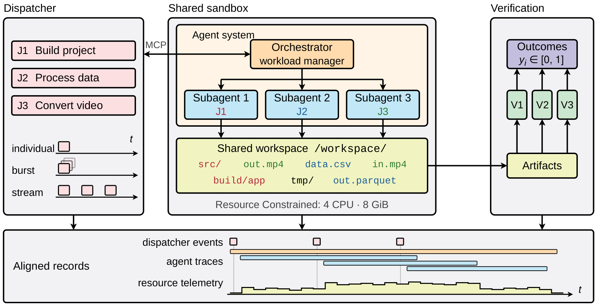

<p align="center">
  
</p>

<h1 align="center">AOS-Bench: Can LLM Agents Manage Dynamic Workloads?</h1>

<p align="center">
  <a href="https://arxiv.org/abs/2610.33178"></a>
  <a href="https://huggingface.co/datasets/AOS-Bench/AOS-Bench-Trajectories-v2"></a>
  <a href="LICENSE"></a>
</p>

<p align="center"><b>English</b> | <a href="README_zh.md">中文</a></p>

Coding agents are moving from handling one request at a time to serving as persistent
assistants that are handed a stream of work: a build, a data-processing job and a bug fix may
all be pending on the same machine at once. The agent then has to decide when to take on new
tasks, how to delegate and overlap them, and how to stay within the machine's CPU and memory.
Existing benchmarks evaluate each task in isolation, so they cannot measure this.

**AOS-Bench evaluates an agent system as a workload manager.** Verified tasks from existing
CLI benchmarks are released over time into one shared container with a fixed CPU and memory
budget, and a single long-running agent must deliver them. Running the same tasks one at a
time gives each system its own isolated reference.

<p align="center">
  
</p>

## Contents

- [How it works](#how-it-works)
- [Key results](#key-results)
- [Installation](#installation)
- [Quickstart](#quickstart)
- [Reproducing the paper](#reproducing-the-paper)
- [Repository layout](#repository-layout)
- [Known limitations](#known-limitations)
- [Citation](#citation)
- [License and acknowledgements](#license-and-acknowledgements)

## How it works

A **workload** (a *stream*) is a set of tasks, each with a natural-language instruction, a
release time and a verifier. It runs as one **trial**:

1. A per-job **dispatcher** releases each task at its release time. The agent reaches it
   through MCP tools (`todo_next`, `todo_list`, `todo_update`). It sees only tasks released
   so far, never the future schedule.
2. The agent decides what to claim, when, and how to run it: in its main session, through
   sub-agents, or with background commands. All of it shares one container with 4 CPUs and
   8 GiB of memory.
3. When the agent's execution phase ends, the dispatcher is closed and every process the agent
   started is stopped. Then each task's verifier grades the final state of the shared
   workspace. Rewards are in [0, 1].

Two comparison settings use the same tasks: **individual** runs each task alone (the isolated
reference), and **burst** releases every task at time zero.

The benchmark runs on [Harbor-AOS](https://github.com/AOS-Bench/Harbor-AOS), a fork of the
[Harbor](https://github.com/harbor-framework/harbor) evaluation harness, included here as the
`harbor` submodule. The tasks and workloads are in
[AOS-Bench-Task](https://github.com/AOS-Bench/AOS-Bench-Task).

## Key results

Five model–harness pairs, three attempts per workload and per task. SR is the mean per-task
reward (%), Δ = stream − individual, and throughput is rewarded work per execution minute
relative to the system's own sequential individual runs.

| System | Harness | Medium SR (Ind → Str) | Medium Δ | Medium thrpt. | Heavy SR (Ind → Str) | Heavy Δ | Heavy thrpt. |
|---|---|---|---|---|---|---|---|
| Claude Opus 5 | Claude Code | 81.5 → 79.7 | −1.8 | 2.06× | 75.5 → 62.5 | −13.0 | 1.85× |
| GLM-5.3 | Claude Code | 74.9 → 53.9 | −21.1 | 1.73× | 60.1 → 44.4 | −15.7 | 2.46× |
| DeepSeek-V4-Pro | Claude Code | 79.5 → 54.4 | −25.1 | 1.49× | 58.1 → 35.4 | −22.7 | 1.57× |
| Kimi-K3 | Kimi Code | 74.3 → 68.1 | −6.3 | 2.22× | 65.3 → 46.0 | −19.3 | 1.77× |
| GPT-5.6-sol | Codex | 85.3 → 70.9 | −14.5 | 1.68× | 71.0 → 52.9 | −18.1 | 1.04× |

- **Isolated skill does not carry over evenly.** On heavy workloads every system loses 13 to 23
  points. On medium workloads the systems span 11 points in isolated SR but 26 points in stream
  SR. GLM-5.3 and Kimi-K3 are 0.6 points apart in isolation, yet deliver 54% and 68% of the
  same tasks.
- **Task intake explains much of the gap.** Serial dispatch leaves 73% of heavy-workload tasks
  unclaimed.
- **More elaborate management is not necessarily better.** A fixed concurrency of two comes
  within four points of the best agent-managed policy on both tiers. Under every policy, median
  CPU use stays below 30% of the provisioned cores while tasks wait.

All trajectories behind these numbers are released, with secrets and internal identifiers
redacted, as the
[AOS-Bench-Trajectories](https://huggingface.co/datasets/AOS-Bench/AOS-Bench-Trajectories-v2)
dataset.

## Installation

Requirements:
- a Linux host with Docker Engine 20.10 or later, the `docker compose` v2 plugin, and cgroup v2;
- [uv](https://github.com/astral-sh/uv) and [Git LFS](https://git-lfs.com);
- Python 3.12 or later.

A stream trial uses 4 CPUs and 8 GiB, so plan for at least 8 CPUs, 16 GiB of memory and about
100 GB of free disk for images.

```bash
# 1. Code, with the harness submodule
git clone --recurse-submodules https://github.com/AOS-Bench/AOS-Bench.git
cd AOS-Bench

# 2. Harness environment, with aos_bench on its path
(cd harbor && uv sync --all-extras)
echo "$(pwd)" > "$(ls -d harbor/.venv/lib/python3*/site-packages)/aos_bench.pth"

# 3. Dispatcher image, built once and shared by all jobs
docker build -t aos-bench/dispatcher:v1 -f aos_bench/pool/Dockerfile.dispatcher .

# 4. Workloads and tasks
git lfs install   # some environment files are stored with Git LFS
git clone https://github.com/AOS-Bench/AOS-Bench-Task.git data
```

Each workload's `stream.toml` pins a prebuilt task image on Docker Hub (`zhuerle/aosbench`),
which Harbor pulls on first use. Run `docker login` first, to avoid anonymous pull limits. To
build an image from its Dockerfile instead, add `--force-build` to `harbor run`.

## Quickstart

Run one medium workload with Claude Code. The run takes up to 2.5 hours.

```bash
export ANTHROPIC_API_KEY=...        # the agent's model key
export OPENROUTER_API_KEY=...       # LLM judge used by a few WildClawBench graders

cd harbor
uv run harbor run \
  --path ../data/stream/V1-0/valid-0917/medium/v1-medium-10-cdf6049a \
  --task-type stream --aos-pool-v03 --env docker \
  --agent claude-code --model claude-opus-5 \
  --ak version=2.1.241 --ak reasoning_effort=high \
  --ak permission_mode=bypassPermissions --ak disallowed_tools=WebSearch,WebFetch \
  --ae ANTHROPIC_API_KEY="$ANTHROPIC_API_KEY" \
  --ve OPENROUTER_API_KEY="$OPENROUTER_API_KEY" \
  --agent-timeout-sec 9000 \
  --jobs-dir ../jobs --n-attempts 1 --yes
```

Each trial directory under `jobs/<job-name>/` contains:

| Path | Contents |
|---|---|
| `verifier/reward.json` | reward per task, in [0, 1] |
| `verifier/scheduling_metrics.json` | release, claim and completion time, and final state, per task |
| `dispatcher/events.jsonl` | every release, claim and status update |
| `agent/` | the agent's transcript and session logs |
| `agent_stop.json` | whether the dispatcher was closed, and how many agent processes were stopped |
| `result.json` | phase timings and the trial outcome |

To watch trials live:

```bash
python -m aos_bench.monitor --jobs-dir jobs --port 4000
```

Other agents: use `--agent codex` (OpenAI-compatible endpoints) or `--agent kimi-code`, with
the matching API key passed through `--ae`. The getting-started guide lists the exact settings
([English](docs/getting_started.md), [中文](docs/getting_started_zh.md)).

## Reproducing the paper

| Setting | Path under `data/stream/V1-0/` | Workloads | `--agent-timeout-sec` | Extra flags |
|---|---|---|---|---|
| Stream, medium | `valid-0917/medium/<workload>` | 10, 10 tasks each | 9000 (150 min) | `--task-type stream --aos-pool-v03` |
| Stream, heavy | `valid-0917/heavy/<workload>` | 5, 20 tasks each | 14400 (240 min) | `--task-type stream --aos-pool-v03` |
| Thirty-task case study | `valid-0917/heavy-plus/<workload>` | 1, 30 tasks | 21600 (360 min) | `--task-type stream --aos-pool-v03` |
| Individual | `valid-0917-individual-dedup/<tier>` | one directory per task | 5400 (90 min) | |

Use `--n-attempts 3`. Every stream runs with 4 CPUs and 8 GiB, as set in its `stream.toml`.
The paper's agent versions were Claude Code 2.1.241 (`reasoning_effort=high`, web tools
disabled), Codex 0.50.0 (`reasoning_effort=high`, `wire_api=responses`) and Kimi Code 0.36.1.

The paper scores results as follows:
- Tasks whose reference solution fails, or whose grader produced a *false zero* (a reward of 0
  written without any test result), are excluded from both settings.
- One LLM-judge task is excluded because its grader cannot run in the sandbox.
- If a stream trial's sampled memory exceeds 8 GiB, tasks completed after the first such sample
  score 0.
- Individual SR is computed over the same tasks as each stream trial.
- Metrics are averaged within each workload, then equally across workloads.

The released trajectories carry everything needed to recompute the tables.

## Repository layout

| Path | Contents |
|---|---|
| `aos_bench/pool/` | task pool and the per-job MCP dispatcher |
| `aos_bench/scheduler/` | fixed execution policies used in the paper's ablations (serial, fixed k) |
| `aos_bench/harness/`, `aos_bench/trace/` | harness integrations and normalization of agent trajectories |
| `aos_bench/monitor/` | live web dashboard for running trials |
| `aos_bench/traj_analysis/` | trial health checks, failure classification and trajectory statistics |
| `aos_bench/task_construction/` | pipeline that merges source tasks into workloads and validates them |
| `harbor/` | Harbor-AOS, the evaluation harness (submodule) |
| `images/` | Dockerfiles for agent runtime images |
| `scripts/` | smoke tests and data utilities |
| `docs/` | [architecture](docs/arch.md), [stream format](docs/tasks/task_stream.md), [task design](docs/tasks/task_design.md), [agent contract](docs/framework/agent_contract.md), [dispatcher](docs/framework/task_assign.md), [verification](docs/framework/verification.md) |

## Known limitations

- **Memory enforcement differs from the paper's sandbox.** In the paper's runs the 8 GiB limit
  was recorded but not enforced by the kernel. Overruns were handled at scoring time, by not
  crediting tasks completed after the first one. Under Docker the limit is a cgroup limit, so
  an overrun triggers the kernel's OOM killer instead.
- **Agent processes after the time limit.** In the paper's runs a time limit did not stop
  background sub-agents. In 33 of the 221 scored stream trials, the dispatcher recorded
  activity after the limit. This release closes the dispatcher and stops all agent processes
  before grading.
- **Shared output files.** Three tasks grade the same file, `/workspace/result.txt`, and five
  medium workloads contain two of them, so those two cannot both pass.
- **Overlapping tiers.** 22 of the 29 scored medium tasks also appear in heavy workloads, so
  tier results are not independent.

## Citation

```bibtex
@article{zhu2026aosbench,
  title   = {AOS-Bench: Can LLM Agents Manage Dynamic Workloads?},
  author  = {Zhu, Erle and Zhang, Genrui and Hu, Keyang and Su, Mingyu and Wang, Hongning},
  journal = {arXiv preprint arXiv:2610.33178},
  year    = {2026}
}
```

## License and acknowledgements

AOS-Bench is released under the [MIT License](LICENSE). Harbor-AOS is a modified version of
Harbor and is licensed under Apache-2.0. Tasks keep the licenses of their source benchmarks,
listed in AOS-Bench-Task.

The workloads are built from tasks of
[Terminal-Bench](https://www.tbench.ai), SkillsBench, TerminalWorld, WildClawBench,
CompileBench, CompileAgent, ParEval and the One Billion Row Challenge. We thank their authors,
and the authors of [Harbor](https://github.com/harbor-framework/harbor).
