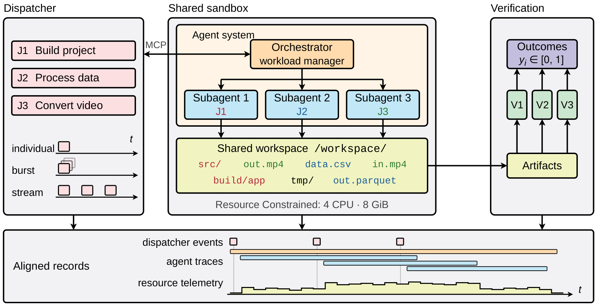

<p align="center">
  
</p>

<h1 align="center">AOS-Bench：LLM Agent 能管理动态工作负载吗？</h1>

<p align="center">
  <a href="https://arxiv.org/abs/2610.33178"></a>
  <a href="https://huggingface.co/datasets/AOS-Bench/AOS-Bench-Trajectories-v2"></a>
  <a href="LICENSE"></a>
</p>

<p align="center"><a href="README.md">English</a> | <b>中文</b></p>

Coding agent 正从一次处理一个请求，转变为常驻的助手。用户会陆续交给它一连串工作，同一台机器上
可能同时挂着一次构建、一个数据处理任务和一个 bug 修复。agent 需要决定何时接新任务、如何委派和
并行执行，以及如何不超出机器的 CPU 和内存。现有 benchmark 都是逐个任务独立评测，测不到这种能力。

**AOS-Bench 把 agent 系统当作工作负载管理者来评测。** 来自现有 CLI benchmark、带可执行验证器的
任务，按时间陆续释放到一个 CPU 和内存预算固定的共享容器中，由同一个常驻 agent 完成。把同一批
任务逐个单独运行，就得到每个系统自己的单任务参照。

<p align="center">
  
</p>

## 目录

- [工作方式](#工作方式)
- [主要结果](#主要结果)
- [安装](#安装)
- [快速开始](#快速开始)
- [复现论文](#复现论文)
- [仓库结构](#仓库结构)
- [已知局限](#已知局限)
- [引用](#引用)
- [许可与致谢](#许可与致谢)

## 工作方式

一个**工作负载**（*stream*）是一组任务，每个任务有自然语言指令、释放时间和验证器。一次运行称为
一个 **trial**：

1. 每个 job 有一个 **dispatcher**，按释放时间放出任务。agent 通过 MCP 工具（`todo_next`、
   `todo_list`、`todo_update`）访问它，只能看到已释放的任务，看不到之后的释放计划。
2. agent 自行决定领取哪个任务、何时领取、如何执行：在主会话里做、交给子 agent，或者用后台命令。
   所有工作共享一个 4 CPU、8 GiB 内存的容器。
3. agent 的执行阶段结束时，先关闭 dispatcher，并停止 agent 启动的全部进程，再由每个任务的验证器
   对共享工作区的最终状态打分，reward 在 [0, 1] 之间。

另有两种对照设置使用同一批任务：**individual** 把每个任务单独运行（单任务参照），**burst** 在
零时刻一次性释放全部任务。

评测运行在 [Harbor-AOS](https://github.com/AOS-Bench/Harbor-AOS) 上。它是
[Harbor](https://github.com/harbor-framework/harbor) 评测框架的一个 fork，以 `harbor`
submodule 的形式包含在本仓库中。任务和工作负载在
[AOS-Bench-Task](https://github.com/AOS-Bench/AOS-Bench-Task) 仓库。

## 主要结果

五个模型–harness 组合，每个工作负载、每个任务各运行三次。SR 是每个任务的平均 reward（%），
Δ = stream − individual。吞吐比是单位执行时间交付的 reward，相对于该系统自己逐个顺序运行的值。

| 系统 | Harness | Medium SR（Ind → Str） | Medium Δ | Medium 吞吐比 | Heavy SR（Ind → Str） | Heavy Δ | Heavy 吞吐比 |
|---|---|---|---|---|---|---|---|
| Claude Opus 5 | Claude Code | 81.5 → 79.7 | −1.8 | 2.06× | 75.5 → 62.5 | −13.0 | 1.85× |
| GLM-5.3 | Claude Code | 74.9 → 53.9 | −21.1 | 1.73× | 60.1 → 44.4 | −15.7 | 2.46× |
| DeepSeek-V4-Pro | Claude Code | 79.5 → 54.4 | −25.1 | 1.49× | 58.1 → 35.4 | −22.7 | 1.57× |
| Kimi-K3 | Kimi Code | 74.3 → 68.1 | −6.3 | 2.22× | 65.3 → 46.0 | −19.3 | 1.77× |
| GPT-5.6-sol | Codex | 85.3 → 70.9 | −14.5 | 1.68× | 71.0 → 52.9 | −18.1 | 1.04× |

- **单任务能力不能原样带到工作负载中。** heavy 工作负载上每个系统都掉 13 到 23 分。medium 上
  各系统的单任务 SR 只相差 11 分，stream SR 却相差 26 分。GLM-5.3 和 Kimi-K3 的单任务表现只差
  0.6 分，在同一批任务上却分别交付 54% 和 68%。
- **差距的很大一部分来自任务领取。** 串行调度会让 heavy 工作负载中 73% 的任务从未被领取。
- **更复杂的管理不一定更好。** 固定并发度为 2 的策略，在两档上都与最好的 agent 自主管理策略相差
  不到 4 分。无论哪种策略，在有任务排队时 CPU 利用率的中位数都低于所分配核数的 30%。

这些结果背后的全部轨迹已脱敏发布为
[AOS-Bench-Trajectories](https://huggingface.co/datasets/AOS-Bench/AOS-Bench-Trajectories-v2)
数据集。

## 安装

要求：
- Linux 主机，Docker Engine 20.10 及以上，带 `docker compose` v2 插件，cgroup v2；
- [uv](https://github.com/astral-sh/uv) 和 [Git LFS](https://git-lfs.com)；
- Python 3.12 及以上。

一个 stream trial 使用 4 CPU 和 8 GiB，建议主机至少有 8 CPU、16 GiB 内存和约 100 GB 可用磁盘
（用于镜像）。

```bash
# 1. 代码，含 harness submodule
git clone --recurse-submodules https://github.com/AOS-Bench/AOS-Bench.git
cd AOS-Bench

# 2. harness 环境，并把 aos_bench 加入其 Python 路径
(cd harbor && uv sync --all-extras)
echo "$(pwd)" > "$(ls -d harbor/.venv/lib/python3*/site-packages)/aos_bench.pth"

# 3. dispatcher 镜像，构建一次，所有 job 共用
docker build -t aos-bench/dispatcher:v1 -f aos_bench/pool/Dockerfile.dispatcher .

# 4. 工作负载和任务
git lfs install   # 部分环境文件使用 Git LFS 存储
git clone https://github.com/AOS-Bench/AOS-Bench-Task.git data
```

每个工作负载的 `stream.toml` 指定了 Docker Hub 上的预构建任务镜像（`zhuerle/aosbench`），
Harbor 首次使用时会自动拉取。建议先 `docker login`，以免触发匿名拉取限额。如果要从 Dockerfile
自行构建，在 `harbor run` 中加上 `--force-build`。

## 快速开始

用 Claude Code 跑一个 medium 工作负载，最长约 2.5 小时。

```bash
export ANTHROPIC_API_KEY=...        # agent 所用模型的 key
export OPENROUTER_API_KEY=...       # 少数 WildClawBench 验证器使用的 LLM 评审

cd harbor
uv run harbor run \
  --path ../data/stream/V1-0/valid-0917/medium/v1-medium-10-cdf6049a \
  --task-type stream --aos-pool-v03 --env docker \
  --agent claude-code --model claude-opus-5 \
  --ak version=2.1.241 --ak reasoning_effort=high \
  --ak permission_mode=bypassPermissions --ak disallowed_tools=WebSearch,WebFetch \
  --ae ANTHROPIC_API_KEY="$ANTHROPIC_API_KEY" \
  --ve OPENROUTER_API_KEY="$OPENROUTER_API_KEY" \
  --agent-timeout-sec 9000 \
  --jobs-dir ../jobs --n-attempts 1 --yes
```

`jobs/<job-name>/` 下每个 trial 目录包含：

| 路径 | 内容 |
|---|---|
| `verifier/reward.json` | 每个任务的 reward，范围 [0, 1] |
| `verifier/scheduling_metrics.json` | 每个任务的释放、领取、完成时间和最终状态 |
| `dispatcher/events.jsonl` | 每一次释放、领取和状态更新 |
| `agent/` | agent 的对话记录和会话日志 |
| `agent_stop.json` | dispatcher 是否已关闭，停止了多少个 agent 进程 |
| `result.json` | 各阶段耗时和 trial 结果 |

实时查看 trial：

```bash
python -m aos_bench.monitor --jobs-dir jobs --port 4000
```

其他 agent：使用 `--agent codex`（OpenAI 兼容接口）或 `--agent kimi-code`，并通过 `--ae`
传入对应的 API key。各 agent 的具体设置见入门指南（[中文](docs/getting_started_zh.md)、
[English](docs/getting_started.md)）。

## 复现论文

| 设置 | `data/stream/V1-0/` 下的路径 | 工作负载 | `--agent-timeout-sec` | 附加参数 |
|---|---|---|---|---|
| Stream，medium | `valid-0917/medium/<workload>` | 10 个，每个 10 个任务 | 9000（150 分钟） | `--task-type stream --aos-pool-v03` |
| Stream，heavy | `valid-0917/heavy/<workload>` | 5 个，每个 20 个任务 | 14400（240 分钟） | `--task-type stream --aos-pool-v03` |
| 30 任务案例 | `valid-0917/heavy-plus/<workload>` | 1 个，30 个任务 | 21600（360 分钟） | `--task-type stream --aos-pool-v03` |
| Individual | `valid-0917-individual-dedup/<tier>` | 每个任务一个目录 | 5400（90 分钟） | |

使用 `--n-attempts 3`。每个 stream 都以 4 CPU、8 GiB 运行，由其 `stream.toml` 指定。论文中的
agent 版本为：Claude Code 2.1.241（`reasoning_effort=high`，禁用网页工具）、Codex 0.50.0
（`reasoning_effort=high`，`wire_api=responses`）、Kimi Code 0.36.1。

论文的计分规则：
- 参考解失败的任务，以及验证器产生过*假零分*（没有任何测试结果却写入 0 分）的任务，在两种设置
  中都排除。
- 一个 LLM 评审任务的验证器无法在沙盒中运行，同样排除。
- 若 stream trial 采样到的内存超过 8 GiB，第一次超限之后才完成的任务记 0 分。
- Individual SR 与每个 stream trial 在同一批任务上计算。
- 各项指标先在工作负载内平均，再在工作负载之间等权平均。

已发布的轨迹包含重算表格所需的全部信息。

## 仓库结构

| 路径 | 内容 |
|---|---|
| `aos_bench/pool/` | 任务池和每个 job 的 MCP dispatcher |
| `aos_bench/scheduler/` | 论文消融实验中的固定执行策略（串行、固定并发 k） |
| `aos_bench/harness/`、`aos_bench/trace/` | harness 接入和 agent 轨迹归一化 |
| `aos_bench/monitor/` | 运行中 trial 的实时网页看板 |
| `aos_bench/traj_analysis/` | trial 健康检查、失败分类和轨迹统计 |
| `aos_bench/task_construction/` | 把源任务合并成工作负载并做验证的流水线 |
| `harbor/` | Harbor-AOS 评测框架（submodule） |
| `images/` | agent 运行时镜像的 Dockerfile |
| `scripts/` | 冒烟测试和数据工具 |
| `docs/` | [架构](docs/arch.md)、[stream 格式](docs/tasks/task_stream.md)、[任务设计](docs/tasks/task_design.md)、[agent 约定](docs/framework/agent_contract.md)、[dispatcher](docs/framework/task_assign.md)、[验证](docs/framework/verification.md)（英文） |

## 已知局限

- **内存限制与论文所用沙盒不同。** 论文运行时，8 GiB 限制只做记录，不由内核强制执行。超限在
  计分时处理：第一次超限之后完成的任务不计分。在 Docker 下这是 cgroup 限制，超限会触发内核的
  OOM killer。
- **超时后的 agent 进程。** 论文运行时，时间限制没有停止后台子 agent。在 221 个计分的 stream
  trial 中，有 33 个在时限之后仍有 dispatcher 活动。本版本在评分前会关闭 dispatcher 并停止全部
  agent 进程。
- **共用输出文件。** 有三个任务的验证器检查同一个文件 `/workspace/result.txt`。五个 medium
  工作负载各包含其中两个，这两个任务无法同时通过。
- **档位之间有重叠。** 29 个计分的 medium 任务中有 22 个也出现在 heavy 工作负载里，因此两档的
  结果并不独立。

## 引用

```bibtex
@article{zhu2026aosbench,
  title   = {AOS-Bench: Can LLM Agents Manage Dynamic Workloads?},
  author  = {Zhu, Erle and Zhang, Genrui and Hu, Keyang and Su, Mingyu and Wang, Hongning},
  journal = {arXiv preprint arXiv:2610.33178},
  year    = {2026}
}
```

## 许可与致谢

AOS-Bench 以 [MIT License](LICENSE) 发布。Harbor-AOS 是 Harbor 的修改版，采用 Apache-2.0
许可。各任务沿用其来源 benchmark 的许可，列在 AOS-Bench-Task 中。

工作负载中的任务来自 [Terminal-Bench](https://www.tbench.ai)、SkillsBench、TerminalWorld、
WildClawBench、CompileBench、CompileAgent、ParEval 和 One Billion Row Challenge。感谢这些
benchmark 的作者，以及 [Harbor](https://github.com/harbor-framework/harbor) 的作者。
